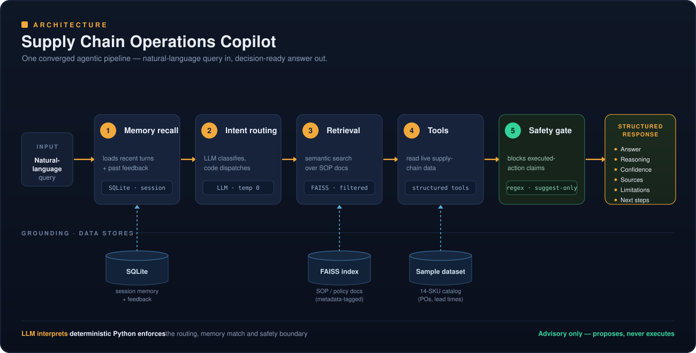

# 📦 Supply Chain Operations Copilot

**An agentic AI decision-support copilot for supply chain operations** — built at the intersection of real manufacturing/supply-chain domain expertise and production-grade agentic AI engineering.

It answers operational questions in plain language — supplier delay risk, inventory stock-out risk, company policy/SOPs — grounds every answer in actual data, remembers the conversation, and stays strictly advisory: **it proposes, it never acts.**

---

### ▶️ Try the live demo

## **[🚀 Launch the copilot →](https://huggingface.co/spaces/Naveenk12/supply-chain-copilot)**

**Sample questions to try:**

```
Are any of my parts likely to stock out?
What's our escalation process when a tier-1 supplier is running late?

Test the conversational memory with this ordered pair:
  Ask:       → Is supplier SKU-1042 at risk of delay?
  Follow-up: → Is that one still at risk of delay?   <- "that one" resolves to SKU-1042
```

> Runs on a small **simulated** sample dataset (a 14-SKU mid-market electronics manufacturer), not any real company's data. Ask about a specific SKU like `SKU-1042`, or tap a suggested prompt. See [`data/skus.csv`](data/skus.csv) for what's in the dataset.

---

## Why this project

Most "AI copilots" are a thin wrapper around a language model. The hard part in supply chain isn't calling an LLM — it's **encoding the operational judgment that makes an answer trustworthy**: knowing that an active PO delay and a structurally long lead time are *different kinds* of risk, that conflicting signals shouldn't be silently averaged, that a system near real operations must never quietly take an action.

This project is that judgment, built into a production-shaped agentic system — the translation layer between supply-chain domain knowledge and modern AI engineering.

## What it does

Each query is routed to the right capability, answered from actual data, and returned in a structured, decision-ready format:

| Capability | Example | What it does under the hood |
| --- | --- | --- |
| **Supplier delay risk** | *"Is SKU-1042 at risk of delay?"* | Distinguishes an **active PO delay** (high-confidence, live risk) from a **structurally long lead time** (weaker, watch-list risk) — and flags a `conflict_note` when the two signals disagree instead of picking one silently. |
| **Inventory stock-out risk** | *"Are any of my parts likely to stock out?"* | Checks a single SKU against its reorder point, or scans the full catalog and returns everything at risk with counts. |
| **Policy / SOP lookup** | *"What's the escalation process for a late tier-1 supplier?"* | Retrieves the relevant procedure from SOP documents via metadata-filtered semantic search and answers **from the source**, citing the document. |
| **Conversational memory** | *"Is that one still at risk?"* | Resolves the reference against the previous turn, and persists across sessions — feedback given once resurfaces on related later questions. |

Every answer returns in the same audit-ready shape — **Answer · Reasoning · Confidence · Sources · Limitations · Next steps** — and carries an advisory notice requiring human approval before any action.

## Architecture

A single **converged orchestrator** processes each query through five stages, each handing off to the next:



### Engineering decisions worth calling out

- **LLM interprets, deterministic code enforces.** The language model does the fuzzy work — classifying intent, resolving references, writing prose. Plain, predictable Python handles routing, tool dispatch, and the safety boundary. The parts that *must* be reliable never depend on model sampling.

- **Metadata-filtered retrieval (filter-then-rank).** Document chunks carry metadata (doc type, topic, criticality tier). The system narrows to the metadata-matching subset **first**, then ranks by semantic similarity — instead of the brittle pattern of semantic-searching everything and keyword-filtering the results afterward.

- **Situation-keyed persistent memory.** History and feedback live in SQLite and are matched by *operational situation* (SKU / supplier / tier), not exact query text — so guidance surfaces on related later questions however they're phrased, and it survives restarts.

- **Determinism where it counts.** Classification runs at temperature 0 for reliable entity extraction; the safety gate is **regex-based, not a second LLM call**, because a safety boundary that behaves differently each time isn't a safety boundary.

- **Suggest-only, enforced by construction.** A deterministic gate inspects the final answer and neutralizes any claim of an executed action, stamping every response advisory — the safety property holds while the system is still read-only, rather than being bolted on after something goes wrong.

The full rationale — **thirteen architecture decisions, each tied to the specific weakness it fixes** — lives in [`docs/decisions_1.md`](docs/decisions_1.md). It documents a deliberate rebuild from a first-pass prototype into this production-shaped architecture.

## Tech stack

`Python` · `OpenAI SDK` · `FAISS` (metadata-filtered vector search) · `SQLite` (persistent memory) · `FastAPI` (service API) · `Gradio` (UI) · `Pydantic` (typed request/response contracts) · `Docker`

## Running locally

```bash
python3 -m venv .venv
source .venv/bin/activate
pip install -r requirements.txt
cp .env.example .env          # then fill in your OPENAI_API_KEY
python ui/app.py              # self-contained app — this is what the live demo runs
```

Then open the URL Gradio prints (typically `http://127.0.0.1:7860`).

<details>
<summary>Alternative: run the FastAPI service separately</summary>

The orchestrator is also exposed as a FastAPI service (`/query`, `/feedback`, `/health`):

```bash
uvicorn app.main:app --reload --port 8000
curl http://127.0.0.1:8000/health   # -> {"status":"ok"}
```
</details>

## Repository layout

| Path | What's in it |
| --- | --- |
| `core/` | Converged orchestrator, intent routing, tools, safety gate, LLM client |
| `retrieval/` | FAISS vector store, embeddings, metadata-filtered search |
| `memory/` | SQLite store + session-facing memory/feedback layer |
| `app/` | FastAPI service surface |
| `ui/` | Gradio interface |
| `data/` | Sample SKU dataset |
| `prompts/` | System / tool / safety prompts |
| `docs/` | Architecture Decision Record (`decisions_1.md`) |
| `tests/` | Per-stage smoke tests |

## Scope & roadmap

Built as a **demonstration of the architecture** on simulated sample data — not a deployment against a live system. Honest boundaries and planned enhancements:

- Explicit follow-ups resolve reliably; resolving *implicit* intent across turns (e.g. *"what about SKU-1002?"*) is a planned improvement.
- On the roadmap: a criticality-tier lookup tool, multi-SKU batch queries, improved reference-resolution reliability, and a formal evaluation harness.

## A note on safety

Recommendations are **advisory**. The system is designed to propose, never to execute — any recommended action is intended for human review and approval. This boundary is enforced in code, not left to the model's discretion.
